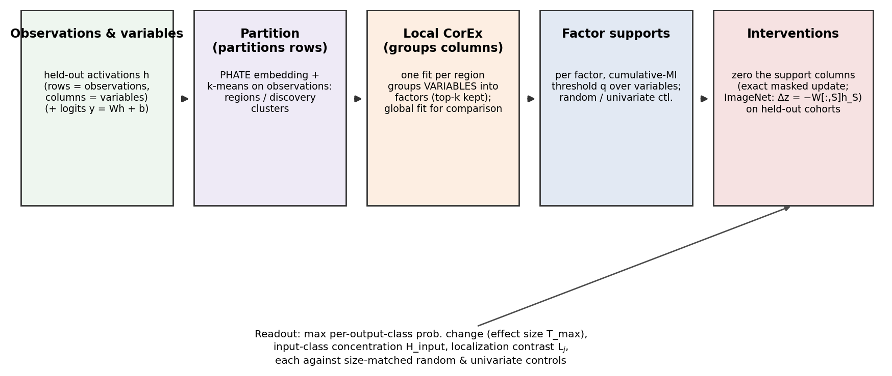
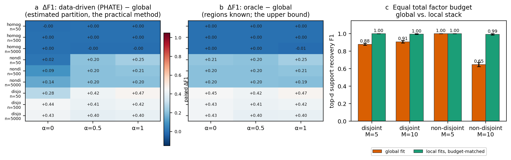
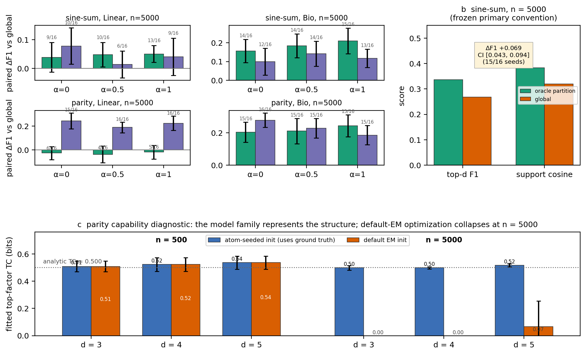
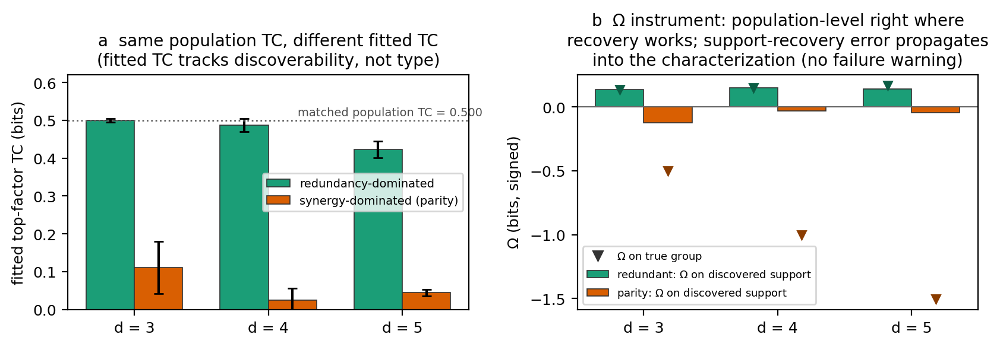
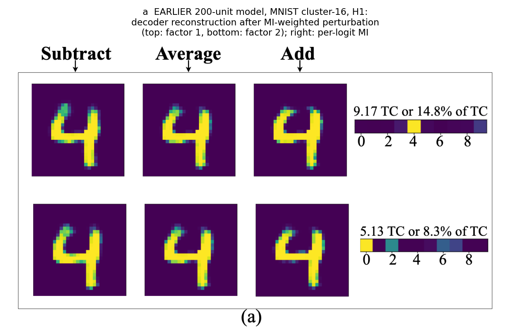
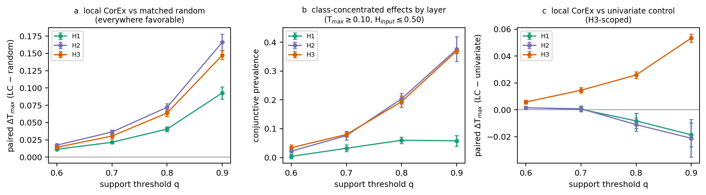
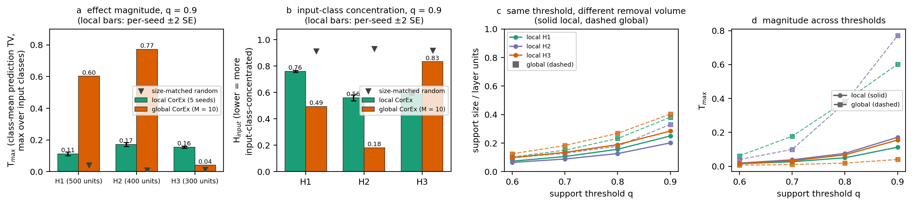
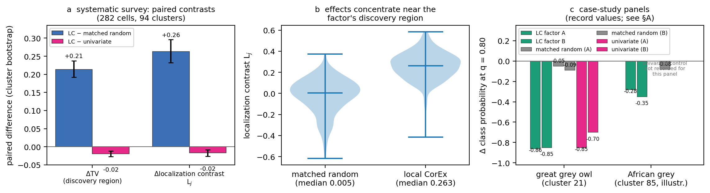

# Local CorEx: Learning Context-Dependent Structure in Data and Neural Representations

**Status: draft manuscript (v0.3) for internal review and external AI
analysis.** Compiled 2026-11-05 from the committed experiment accounts of
record (`paper/exp3.md`, `paper/exp4.md` §E4.16 + `exp4_addendum_global_arm.md`,
`paper/exp5.md`), the pre-drafting audit (`paper/claim_evidence_table.md`),
and the committed results CSVs. v0.2 adopted the first external review
(`manuscript_feedback.md`). v0.3 adopts the second review round:
publication provenance is separated (MLSP = the extended prior publication;
dissertation content explicitly attributed as such; new experiments as
journal contributions); Figure 3's two analyses are reconciled (panel b is
now computed, not hard-coded, and the exact convention differences are
listed); the metric definitions are matched in text and figures (T_max as
a class-mean TV distance over input classes, per-image complements
added); the Gaussian capacity decline's scoring mechanism is identified
from the store; the Figure 6 support-size differences are explicitly
reported (not controlled); the E5 control-pairing bug is fixed in the
committed summarizer with a documented no-change regeneration
(`paper/figures/check_e5_pairing_fix.py`); Figure 7's panels are labeled
with their earlier-analysis provenance and its caption errors are fixed;
conceptual definitions (TC, piecewise-linear scoping, O-information
reading) are corrected. Figures live in `paper/figures/` and are
regenerated by `paper/figures/make_paper_figures.py`.

---

## Abstract

Dependence structure in data — and in the representations of trained
neural networks — varies across the data manifold. A global factor model
must fit one factor budget to all of it, while a *local* variant fits
separate models to discovered regions. This paper establishes, through
controlled experiments, when localization improves the recovery of
context-dependent dependence groups, and uses neural interventions to
assess the behavioral relevance of the resulting groups. On Gaussian grids
where the grouped covariance varies across regions, localizing improves
top-d support recovery dramatically given an informative partition
(data-driven partition 0.980 vs. global 0.788 F1; +0.192, CI [0.177,
0.207]), the gain survives equal total factor budgets and an alternate
estimator, and it disappears exactly where it should (homogeneous data). A
per-estimator analysis of pairwise-invisible nonlinear generators shows
the gain persists (Bio: +0.10–0.28 F1; Linear: +0.03–0.05 F1 for
continuous), with parity stress cases and capability diagnostics locating
the remaining failures in optimization, not expressiveness. A matched-TC
study then draws the interpretive boundary: fitted TC-side summaries do
not support a reliable, general reading of interaction type, because they
also trace recoverability; the signed Ω diagnostic and the behavioral
probe answer different, complementary questions. On MNIST (5-seed MLP),
systematic ablations show local-CorEx groups are behaviorally consequential
for their size (larger, more class-concentrated shifts than size-matched
random deletion at every layer × threshold), with localization's aggregate
advantage over prediction-guided single-unit selection concentrating at
the deepest layer, and with local and global fitting identifying groups
with different layer-dependent behavioral profiles. On ResNet-18/ImageNet
(282 (cluster, factor) cells, 94 clusters, exact pooled-feature deletion)
the protocol transfers unchanged: ΔTV +0.214 vs. matched random
(CI [0.192, 0.238]), and case panels show class signal identified on
discovery data collapsing the right class out of sample (owl −0.86 vs.
−0.05 for matched randoms). Throughout we keep separate how much
predictions change (a class-mean TV measurement over output coordinates,
maximized across input classes), how concentrated the changes are across
input cohorts, and which images experience the largest per-image shifts.

---

## 1. Introduction

Higher-order interactions — dependence among several variables that is
not reducible to pairwise relationships — are hard to detect, and harder
still when they *vary across contexts*. Total Correlation Explanation
(CorEx) learns latent factors that explain the total correlation (TC) of
a dataset, and its variants Linear CorEx (modular, Gaussian) and Bio CorEx
(continuous/missing-data, discrete latent) identify groups of dependent
variables whose structure is recovered through each factor's mutual
information with the original features. The prior conference work (Kerby,
White & Moon, MLSP 2024) established Local CorEx — partitioning
observations with PHATE + k-means and fitting CorEx per cluster — and
showed on Gaussian recovery data and selected MNIST examples that local
fits outperform global fits when interactions vary across the manifold.
The dissertation chapter expanded the
applications (tabular communities
data, flattened MNIST pixels, classifier layers, ResNet-18/ImageNet) and
added qualitative visualizations (decoder reconstructions, DeepDream).
Three publication layers are distinguished: material already in the MLSP
paper is the prior publication the journal article extends;
dissertation-only results not published elsewhere are eligible
first-journal-published content, cited to the dissertation; and the new
experiments here are journal contributions in their own right. The
dissertation's ImageNet case study is therefore legitimately part of the
extension (with attribution), while the systematic ImageNet study below
(control-matched survey, explicit discovery/evaluation split,
cluster-level bootstrap) is new.

Those results alone do not establish *when* localization helps, or
*whether* the resulting groups are behaviorally meaningful under
controls. The journal contribution is precisely that step: **Local CorEx
discovers groups of dependent variables whose structure varies across
contexts. Controlled experiments establish when localization improves
recovery, and neural interventions assess the behavioral relevance of the
resulting groups.** Relative to the MLSP paper — and for the
dissertation-published applications, in their first journal form — the
advance here is the layer of controlled comparison: matched partitions
and controls, equal-budget checks, held-out intervention protocols, and
stated uncertainty, none of which the earlier applications carried.

The named contributions, each carried by one experiment:

1. **Operating conditions (E1, Fig. 2).** A 27-condition × 16-replicate
   Gaussian grid separates the factors behind the average: the
   strongest general pattern is the covariance regime — the
   localization benefit vanishes in the homogeneous control, is small
   and sample-size-dependent in the shared-structure (nondisjoint)
   regime, and is large regardless of size or separation when each
   region's covariance structure is incompatible (disjoint). It also
   requires an *informative* partition (random partitions do not beat
   global) and is not explained by the local arm's larger factor budget
   (equal-budget control).
2. **Boundary and estimator responsibility (E2, Fig. 3).** The same
   question under pairwise-invisible nonlinear structure. Every headline
   number is labeled with its CorEx estimator; estimated partitions are
   shown alongside the true-region reference partition; two reconciliation
   conventions are stated (§4.2) and the parity-inversion pattern is
   reported directly.
3. **Interpretive boundary (E3, Fig. 4).** What information about
   dependence structure survives fitting and support selection.
   Population TC does not uniquely determine redundancy vs. synergy
   dominance; *fitted* TC additionally traces recoverability; and neither
   statistical dependence nor recovery quality determines a group's
   behavioral role. The larger diagnostic grid moves to supplement.
4. **Systematic neural evidence, with its two separated questions (E4,
   Figs. 5–7).** Discovered MNIST groups are behaviorally consequential
   relative to *arbitrary* (size-matched random) groups of the same size;
   whether the multivariate factor model adds anything beyond a simpler
   prediction-guided single-unit selector is a separate question with a
   layer-dependent answer. A direct local/global comparison on the same
   measurements is added, and qualitative examples from the dissertation
   restore an intuitive reading of what the factors capture.
5. **Protocol transfer (E5, Fig. 8).** The instrument, protocol-frozen and
   unmodified, on a large pretrained network with an explicit
   discovery/evaluation split and cluster-level uncertainty.

**Scope.** The Gaussian grids validate recovery of *multivariate
dependence groups* whose structure is specified through covariance; they
do not establish recovery of interactions irreducible to pairwise
relationships — that boundary is E2's subject. The communities, dropout,
and pixel-group applications of the dissertation chapter are left outside
this manuscript (each introduces its own new scientific questions; see
§9, and the dropout study as a companion-paper direction).

**Explicit non-claim.** No claim that a recovered factor's statistics
reveal interaction *type* (redundancy vs. synergy), nor that TC magnitude
predicts functional properties beyond what the intervention instrument
directly measures. Recovery, interaction-type characterization
(computable only on tractable joints), and intervention are measurement
vocabularies: O-information characterizes statistical dependence;
deletion measures behavioral contribution. Deleting a group does not
establish whether its underlying dependence is redundancy- or
synergy-dominated.

## 2. Background and setup

### 2.1 Total correlation and CorEx

Let X = (X₁,…,X_p) be observed variables and Z = (Z₁,…,Z_m) latent
factors. The total correlation of X is
TC(X) = KL(p_X ∥ ∏ᵢ p_{Xᵢ}) — the generalization of mutual information
to many variables. CorEx maximizes the explained total correlation
TC(X;Z) = TC(X) − TC(X|Z): *Linear CorEx* assumes X is jointly Gaussian,
learns Z = WX + ε with independent modular factors, and supports parallel
factor learning; *Bio CorEx* is distribution-free in X with discrete
factors, suited to missing/undersampled data but more expensive. Each
factor's importance is its explained TC; the predicted interaction group
("HOI") of a factor is the set of variables with high mutual information
with it, ranked per factor. Throughout, ranking rules never select on
estimated TC across arms being compared; supports use a fixed
cumulative-MI threshold rule per factor.

### 2.2 Partitions: what is clustered and what is grouped

Two distinct operations must not be conflated:

- **PHATE + k-means partitions *observations*** (rows): the data
  manifold is embedded (10-d by default) and clustered into regions;
- **CorEx groups *variables*** (columns): within each region, a fit on
  the **original variables** (never the plotting coordinates) yields
  factor–variable MI scores that define interaction groups.

Fitted per region, the local *Linear* CorEx configuration is
piecewise-linear, which makes it fast (parallel Linear CorEx per region)
and empirically capable on mildly nonlinear data (the experiments below);
this scoping applies to the Linear configuration only and is not a claim
that partitioning makes every CorEx estimator robust to nonlinear
dependence. Hyperparameters (embedding
dimension, k, factors per fit, cumulative-MI threshold q) are fixed per
experiment below.

### 2.3 Three measurement vocabularies

- **Recovery** — does the fit rediscover the generating groups?
  (matched/top-d precision, recall, F1, cosine overlap).
- **Type characterization** — redundancies vs. synergies via signed
  O-information Ω, computable only where the joint is tractable.
- **Intervention** — behavioral effect of zeroing a factor's support on
  images the selection stage never saw.

## 3. Shared design conventions

1. **Paired design.** One dataset per condition, shared by every method
   compared on that condition; method differences are read like-for-like.
2. **Derived seeds.** Seeds are hashes of (root, purpose, condition);
   re-running a condition reproduces its data bit-for-bit.
3. **Discovery/evaluation separation.** Everything that selects
   (clustering, fitting, support thresholds, ranking) sees only discovery
   data; outcomes are computed on evaluation data the selection stage
   never saw.
4. **Restartability and failure-as-data.** Conditions write atomically
   and skip on rerun; failed fits are recorded with status, never
   silently dropped. (E1/E2/E3 grids: zero failed fits across all
   conditions.)
5. **Uncertainty discipline, labeled per figure.** Paired t-based 95% CIs
   across 16 synthetic replicates (df = 15; Fig. 3 uses 2.131·SE);
   cluster-level bootstrap (B = 2000) for the ImageNet survey (Fig. 8, as
   committed); the MNIST contrasts (Figs. 5–6), as stored in the
   committed tables, are ±2·SE of the 5-seed aggregate (unit:
   (seed, cluster, layer, factor, intervention) pool; with 5 network
   seeds the normal approximation understates the interval, so those
   error bars are read as scale indicators and the per-seed values in the
   account serve as the primary uncertainty statement). Factor-level
   units are labeled as pseudo-replicates throughout.
6. **Matching conventions are stated per experiment and never mixed
   silently.** E1's primary score is *matched* top-d F1 under a
   one-to-one (Hungarian) alignment between learned factors and true
   groups — a recall-or-precision view of the whole factor collection.
   E2's primary convention is *per-true-group best top-d match* (each
   true group takes its best candidate factor) — a recall-flavored view
   that is *favored* by larger candidate pools (see the chance-reference
   note below). E2's
   sensitivity arm keeps a pooled all-rows convention. Chance references
   use the same candidate-factor pool and matching procedure as the
   scored arm (§4.3); because the per-true-group-best rule rewards larger
   candidate pools, random-partition rows in E2 are read only for
   qualitative sanity, not as calibrated baselines.

| Table 1 — benchmark conditions |
|---|
| **E1 Gaussian** | 3 covariance regimes × 3 region sizes × 3 mean separations; 16 paired reps; Linear + Bio estimator; partitions {true-region reference, PHATE, random}; equal-budget capacity arm (M ∈ {5,10}) |
| **E2 nonlinear** | sine-sum (continuous, pairwise-invisible) + parity (discrete, pairwise-invisible) + product (supplementary, *not* pairwise-invisible); 2 regions with incompatible group structure; n ∈ {500, 5000} × α × noise; Linear + Bio |
| **E2 parity stress** | parity block alone; default-EM vs. ground-truth atom-seeded init at equal state cardinality; 8 reps/cell |
| **E3 type boundary** | redundant vs. parity generators calibrated to exactly TC\* = 0.500 bits; d ∈ {3,4,5}; n ∈ {500,5000}; 32 paired reps; 768 conditions |
| **E4 MNIST** | 5 network seeds; 3 layers (500/400/300 units); 20 discovery clusters (PHATE + k-means on 10k discovery images); per (seed, cluster, layer) Linear CorEx, top-5 positive-TC factors; q ∈ {0.6,0.7,0.8,0.9} (+0.95/0.99); global-CorEx arm (M ∈ {10,100}); 141k + 66k + 66k intervention evaluations, zero failures |
| **E5 ImageNet** | ResNet-18 on full ImageNet val (50k images); discovery = 25/class, evaluation = 25/class; k = 100 clusters; M = 10, top-3 retained; q = 0.80; 282 (cluster, factor) cells in 94 clusters; 5 matched-random + univariate per cell |

## 4. Controlled recovery

**Figure 1 — the shared pipeline.** PHATE + k-means partitions
*observations* (rows); per-region local CorEx groups *variables*
(columns) into factors (with a global fit for comparison); per-factor
cumulative-MI supports over the original variables; exact masked
interventions; held-out behavioral readout (T_max class-mean TV over
output coordinates, maximized across input classes; input-class
concentration H_input; localization contrast L_j) against
size-matched random and univariate controls.

### 4.1 Gaussian grids: the operating conditions (E1)

Two equally sized Gaussian populations over 25 signal variables in five
disjoint groups of five (equicorrelation ρ = 0.7 within groups). Three
covariance regimes fix how *incompatible* the regions' group structures
are: *homogeneous* (identical), *nondisjoint* (regions share most groups,
partially overlapping), *disjoint* (no shared groups). Mean separation α ∈
{0, 0.5, 1.0} controls partition difficulty; region sizes {50, 500, 5000};
16 paired replicates per condition; true-region reference, PHATE +
k-means, and size-preserving random partitions; matched top-d F1 under
one-to-one alignment.

**Figure 2 — the conditions behind the averages.**
(a) Data-driven (PHATE) − global paired ΔF1 per condition: exactly zero
across the homogeneous control; the disjoint regime is large at every
condition (+0.28…+0.47, roughly flat in α); *within* the nondisjoint
regime the gain grows with region size (+0.02 at n = 50 → +0.14 at
n = 5000) but is not monotone in mean separation (largest at α = 0) —
so size and separation effects are conditional on the regime, and the
regime is the strongest general pattern. (b) True-region reference −
global: ≈ +0.20 nearly everywhere the regions exist (up to +0.47),
including small-n disjoint where the PHATE partition fragments. The
true-region partition is called a *reference*, not an upper bound: §4.2
shows an estimated partition can outperform it for a particular
estimator. (c) Equal total factor budget
(global M factors vs. the budget-matched stack of the two local fits,
identical support sets and one-to-one matching): disjoint M = 5: global
**0.880** vs. local **1.000** (paired Δ −0.120, SE 0.013); M = 10: 0.909
vs. 0.996; nondisjoint M = 5: 1.000 vs. 1.000 (tie); nondisjoint M = 10:
global **0.649** vs. local **0.992** (Δ −0.344).

*Conditions that fail, kept visible.* In the homogeneous regime the
localization gain is zero (global = reference ≈ 1.000): localization
needs heterogeneity. Random partitions do not beat global under the
matched convention (Δ +0.021, CI [−0.001, +0.042] crosses zero): the
partition must be informative. TC is not a recovery proxy: random
partitions explain *more* TC than the reference (2.287 vs. 1.439 bits
per fit), so explained TC alone cannot rank partitions.

*The nondisjoint M = 10 decline: mechanism identified from the store.*
Because the pooled nondisjoint ground truth has 10 groups, the
one-to-one assignment at M = 10 is square — extra factors cannot be
ignored, and the scoring must still match every group to a factor. The
per-replicate store decomposes the decline into two measured
components: (i) ≈0.9 of the 10 fitted global factors per replicate are
nonnegligible-but-degenerate (empty top-k support → scored 0; degenerate
fraction 0.09–0.20 across replicates, maximum 2/10); (ii) the remaining
≈9 matched factors recover only ≈ **0.715** of their pooled group's
members on average (matched non-degenerate F1 range 0.64–0.825; mean
matched cosine similarity 0.73) — mixture supports that straddle the
overlapping group boundaries — versus F1 = 1.00 with zero degenerates at
M = 5 in the same regime, and disjoint M = 10 global fits with zero
degenerates (matched cosine 0.83, F1 0.91). So the decline is an
observed refit-and-scoring effect specific to the pooled overlapping
structure under extra budget — the reporting score *does* penalize
degenerate matches, and the partial supports are measured directly —
not a claim that added budget loses previously-good matching targets.
The budget-matched local stack (0.99) shows the pooled scoring
convention itself is not the cause. We therefore report the decline as
an observed global-fit, regime-specific behavior and do not carry a
broad capacity argument on it alone (the neural analogue — extra budget
leaving the retained top-5 factors' explained TC unchanged — is §6.5's
M = 100 check, phrased narrowly there).

*Validity note.* The Gaussian design specifies structure through
covariance: it validates recovery of grouped *multivariate dependence*,
whose interactions are pairwise-visible in the Gaussian case. Higher-order
pairwise-invisible structure is E2's subject.

*Estimator generality.* On the single check condition (n = 500, α = 0.5)
under Bio CorEx, the gain reproduces (true-region reference 0.992 /
PHATE 0.988 vs. global 0.659). Bio's cost profile on the neural scale is
addressed
separately (§6, pilot verdict; the estimator-generality claim carried by
the synthetic grids, not by a neural Bio arm, which was declined on
feasibility).

### 4.2 Pairwise-invisible nonlinear structure (E2)

Groups carry dependence invisible to any pairwise scan: **sine-sum**
(continuous; Y = sin(ΣΘᵣ) + ε, marginally independent of each angle) is
the primary generator; **parity** (discrete; the d-th variable XORs the
others with flip noise) is the stress case; **product** is a supplementary
comparison that is nonlinear but *not* pairwise-invisible and is never
used as such. Two regions carry deliberately incompatible group
structures; two routing variables encode region identity (excluded from
scoring); nuisance columns grow dimensionality without structure. Each
headline says which estimator produced it.

**Figure 3 — one reproducible primary calculation, one clearly defined
sensitivity analysis, and the capability diagnostic.** Both quantitative
panels are now computed from the committed combined match tables by the
committed figure script.
(a) *Sensitivity analysis, per condition:* paired ΔF1 vs. global under
the per-true-group best-match convention, computed separately for each
(α, noise, estimator) condition and paired within it across the 16
seeds (95% t CIs, df = 15; labels show wins/16; n = 5000, noise 0.05
shown; averaging over all noise levels leaves every sign unchanged).
Both the true-region and the **estimated PHATE partition** beat global
for the Bio estimator (sine-sum: +0.16…+0.21 / +0.10…+0.14; parity:
+0.20…+0.24 / +0.19…+0.28). Under Linear the sine-sum gains are smaller
(+0.03…+0.05; PHATE +0.01…+0.08) and the parity pattern is inverted: the
true-region partition does *not* beat global (−0.02…−0.04, consistent
with this record's own linear-parity entry, ΔF1 −0.052,
CI [−0.093, −0.010]) while **PHATE does** (+0.19…+0.24, 15–16/16 seeds).
(b) *Primary convention, computed and labeled:* the frozen analysis
convention — per-(seed, α, noise, region, group) best match over **all
candidate factors**, per-condition means weighted equally within each
seed across all 3 α × 3 noise levels, seed-level pairing with a t(15)
95% CI — **Bio estimator** (the linear reference values are annotated as
absolute scores, not deltas): sine-sum n = 5000, F1 **0.337 vs. 0.268**
(Δ **+0.069**, CI [0.043, 0.094], 15/16 seeds), cosine **0.383 vs.
0.319** (Δ +0.064, CI [0.043, 0.085]); parity n = 5000, F1 0.425 vs.
0.263 (Δ +0.161, CI [0.123, 0.200]), cosine 0.438 vs. 0.282
(Δ +0.156, CI [0.118, 0.194]). (c) *Parity capability diagnostic*
(8 reps/cell; EM-fitted variant): the model family *represents* the
parity structure at the tested cardinality — a ground-truth atom-seeded
init reaches ≈ the analytic 0.500-bit TC at every cell — while the
default-EM init collapses to 0.0000 bits in 8/8 replicates at n = 5000
(d = 3, 4) — an optimization failure from the default initialization, not
an expressiveness failure (consistent-with, not a proof). The diagnostic
is a statement about the EM-fitted variant's basin structure; it does
not explain the Linear CorEx parity result in panel (a).

**Reconciliation of the two conventions (why (a) and (b) differ).** The
candidate-factor pool and the best-match rule are *identical* (all
learned factors; per-true-group best), as are the nuisance settings
entered (the core grids are single-nuisance, so no nuisance weighting
arises) and the region handling (both keys include the region
identifier; each true group belongs to exactly one region, so
best-per-group is unaffected by it). Three settings differ: (i) the
input-variant rows scored — for the continuous grid the Bio fits exist on
two input variants and (b) scores the primary one (`binned_with_routing`,
with the linear reference annotated as absolute scores), while (a) scores
each estimator on its committed rows (the discrete grid has a single
variant, so (i) applies to the continuous generator only); (ii)
weighting — (b) averages per-condition values within each seed
(every α × noise cell weighted equally) and then pairs at the 16 seeds,
whereas (a) pairs within each condition separately, so (a) shows the
per-condition spread that (b) pools; (iii) interval — both t(15) 95%
CIs, now labeled. Directionally the two analyses agree everywhere;
the absolutes differ because (b)'s equal weighting across the 9
conditions of each generator (3 α × 3 noise, including easy low-noise
cells) shifts the means relative to
any single-cell reading, as panel (a)'s dispersion makes visible.

**The linear-parity pattern, reported directly.** For the *Linear*
estimator on parity data at n = 5000, PHATE partitions help while the
true-region partition does not. The cause is not established by the
current evidence. Two candidate explanations are recorded without
commitment: PHATE conditioning may create locally pairwise-visible
structure within otherwise pairwise-invisible populations (the sort of
conditional structure Parity's XOR destroys globally), or it may be an
artifact of fit selection/scoring across partition sizes. The EM
capability diagnostic in (c) applies to the EM-fitted parity fits of E3,
not to Linear CorEx's fitting procedure, and is not offered as the
explanation of the linear-parity inversion.

The honest composite: **nonlinear success depends on both partitioning
and the estimator; with the appropriate estimator and the practical
partitioned configuration, localization improves group recovery;
support-level precision stays moderate (cosine 0.383 at n = 5000 under
the primary convention).**

### 4.3 Matching conventions, stated and separated

E1's matched top-d F1 (one-to-one Hungarian over the full factor
collection) and E2's per-true-group best match answer different recovery
questions, and neither is silently traded for the other. Within each
experiment the conclusion is checked against a comparable convention:
E1's equal-budget arm reproduces the E1 conclusion under per-factor
best-match scoring as well; E2's pooled all-rows convention is retained as
a labeled sensitivity reading (same signs, smaller margins). Chance
references are computed with the same candidate-factor pool and matching
procedure as the scored arm — under per-true-group best-match rules,
larger candidate pools reward more factors, so random-partition rows in E2
(a 10× larger pool) are not calibrated baselines and are read only
qualitatively.

## 5. Interpretive boundary: what survives fitting and support selection (E3)

Three claims are distinct and must not be fused:

1. **Population TC does not uniquely determine redundancy vs. synergy
   dominance** — two generators with identical TC can carry opposite
   higher-order structure.
2. **Fitted (explained) TC additionally depends on the estimator and
   optimization** — a fit's TC-side summaries trace *whether the
   optimization found the structure*, not only the type.
3. **Statistical dependence does not determine a group's behavioral role**
   — even a perfect characterization of the dependence is a different
   measurement than what removing the group does to a network. (The
   intervention experiments answer that third question; they do not sign
   interaction type.)

E3 addresses the first two by construction: a redundancy-dominated and a
synergy-dominated (parity) generator are calibrated to **exactly the same
population TC** (TC\* = 0.500 bits, residual error < 1e-6); population Ω
is +0.133…+0.166 (redundant) vs. exactly −(d−2)·TC = −0.500…−1.500
(parity), while pairwise MI is 0.074–0.211 vs. exactly 0.

**Figure 4 — the boundary in two panels.**
(a) At matched population TC = 0.500 (dotted line), fitted top-factor TC
differs sharply by generator (redundant 0.42–0.50 bits vs. parity
0.02–0.11; main arm n = 5000, 11/12 cells outside the ±0.05 equivalence
margin). The one inside the margin (d = 3, n = 500) is exactly the cell
where both structures recover perfectly (top-d F1 = 1.0 both sides).
Read not as "TC is blind to type" but as: **fitted TC summaries do not
provide a reliable, general interpretation of interaction type — they
also encode recoverability** (mechanism-capacity matches and EM basins; §4.2).
(b) The signed instrument, read as *the effect of support-recovery error
on subsequent characterization*: Ω on the *discovered support* equals
population Ω wherever the support matches the true group (all redundant
n = 5000 cells; parity d = 3) and — when recovery fails — returns a value
near zero (parity n = 5000: −0.03…−0.12 on the support vs.
−0.50…−1.50 on the true group, markers) **without any warning that
important variables were missed** — this silent failure, not a dramatic
one, is precisely the limitation the experiment demonstrates. Recovery
quality is not a safe proxy for "the structure understood", and Ω itself
estimates to ≈0.01 bits at n = 5000 when computed on the correct
columns.
The full 768-condition grid (32 paired replicates, 5 EM restarts, zero
failed fits, ≈64 CPU-h) moves to supplement.

## 6. Neural representation analysis I: MNIST

### 6.1 Shared neural setup (read before both neural experiments)

The table below fixes, in one place, the design elements common to E4 and
E5. "Held out" always means *held out from factor discovery*; network
training uses its own supervised split and never sees the discovery or
evaluation pools of the intervention stages.

| Design element | Definition |
|---|---|
| Discovery pool (E4) | 10,000 images **from the training split**, stratified (recorded indices), excluded from classifier training per the run's recorded split — an account-of-record assertion not re-verifiable from the committed files alone (flagged §A); drives PHATE clustering, CorEx fits, ranking, supports, qualitative selection |
| Evaluation pool (E4) | the untouched 10,000-image **canonical test split** — used only for intervention outcomes |
| E5 pools | full ImageNet val: first 25 images per class = discovery (HF row order), remaining 25 = evaluation; evaluation images routed to clusters by the frozen fallback (nearest discovery neighbor) after standardization |
| Partition construction | discovery **images** 512-d pooled (E5) or flattened (E4) activations → PHATE → k-means; one partition shared by all layers/factors; deterministic refit reproduces assignments exactly (E4: agreement 1.0000 over 10,000) |
| Factor inputs | *output-aware*: standardized hidden activations + row-centered standardized logits (logits aid interpretability); *hidden-only*: activations alone |
| Support construction | per factor, rank per-variable MI and take the smallest prefix whose cumulative share reaches q; the denominator counts activation coordinates (logit columns excluded); supports are precomputed on discovery data |
| Interventions | E4: activation masking, deterministic, dropout off (eval mode), trunk-equivalent to full masked forward (unit-tested); E5: exact pooled-feature update Δz = −W[:,S]h_S, demonstrated against re-forwards (max logit absdiff 3.6e-5 ≤ 1e-4 frozen tolerance) |
| Matched random controls | E4: 20 (output-aware) / 5 (hidden-only) uniform draws of the same size within the layer; E5: 5 draws per support |
| Univariate control | the top-s units by |correlation| with the factor's most-associated logit **within the same discovery cluster**, on centered logits; E4: output-aware arm only; E5: per cell, same cohort |
| Behavioral metrics | per **input class** y (cohort): class-mean prob vector Δ_{y,c} = E[pᶜ_c(X) − p_c(X) \| Y=y] over **output coordinates** c; T_y = ½Σ_c\|Δ_{y,c}\| — i.e. T_y is the **total-variation distance between the class-mean prediction vectors**, and T_max = max_y T_y (a maximum over input classes, not over output coordinates, not measured in bits); r_y = T_y/Σ_u T_u and **H_input** = normalized entropy of r (concentration **over input classes**; a related output-coordinate concentration H_output is stored); **L_j** (E5) = (tv_source − tv_off)/(tv_source + tv_off), tv = aggregated probability-model distance on the discovery- vs. off-cluster cohorts; complementary **per-image** summaries collected in the same evaluations: U_y = mean ½\|\|p_iᴬ − p_i⁰\|\|₁ (cancellation-free) and prediction-flip rates |
| Conservation & scale | each Δ_{y,·} sums to zero over c (class *means*, exact), so single-class probability drops imply gains elsewhere; probability and logit scales are distinct (logit shifts are not conserved) |
| Uncertainty | E4: 5 network seeds; per-seed results always available; E5: cluster-level bootstrap (B = 2000), conditional on the analyzed network and split; factor rows are pseudo-replicates |

### 6.2 Instrument and grid (E4)

Spec-exact MLP (d ≈ 500/400/300 hidden units per layer); 5 independently
initialized models (test accuracy .9860–.9864); discovery pool and test
pool disjoint as above; per (seed, cluster, layer) Linear CorEx fits,
top-5 positive-TC factors; q ∈ {0.6,0.7,0.8,0.9} (supplementary 0.95/0.99);
141,000 output-aware + 66,000 hidden-only + 66,000 re-evaluation
intervention rows, zero failures.

### 6.3 Qualitative examples: what a factor looks like

**Figure 7 — illustrative examples from the *earlier* analysis
(dissertation Ch. 2; conference panels retain their MLSP attribution).
Provenance differs from the benchmark:** (a)–(b) come from an earlier
2-hidden-layer MNIST network with **200-unit layers**, whose hidden
representations were clustered on the **test data** with selection by
top mutual information and fixed-size deletions — not the
500/400/300-unit benchmark model, its discovery/evaluation split, or its
matched controls; (c)–(d) are the dissertation's ResNet-18 case study
(cluster 58), likewise selected without the §7 controls. They
illustrate what the method finds under an earlier configuration and must
not inherit the benchmark's selection-discipline statements.
(a) MNIST: for a 4/9-heavy cluster, factor 1 of the H1 fit carries
TC ≈ 9.2 bits (14.8% of the layer's): perturbing its nodes in proportion
to their MI bends the digit's top-left stroke toward a 9, and the
factor's MI profile concentrates on one logit (4). Factor 2 (5.1 bits)
shifts the middle bar and base. (b) Deleting those node groups
(row = factor, columns = layers H1/H2) selectively damages 4/9 clusters
(2, 10, 16) while most clusters are nearly unaffected — for factor 2,
6-heavy clusters are also hurt. (c) Feature-weighted DeepDream on the
African-grey cluster's retained factors highlights feather-like textures
(factor 1: neck/chest/head plumage; factor 5: the white eye patch).
(d) Deleting factor 1's top 100 units drops only the African grey
**logit** (−0.91); the other illustrated logits move by ≤ +0.01 — a
logit-scale statement, not a probability-conservation statement. None of
the paper's quantitative claims rests on these panels.

### 6.4 Systematic benchmark results

**Figure 5 — MNIST benchmark** (error bars: ±2·SE of the 5-seed
aggregate, as stored; scale indicators — see §3.5).
(a) Local-CorEx supports produce larger class-mean TV shifts than
size-matched random deletion at **every** layer × threshold × seed
stratum (H2, q = 0.9: paired ΔT_max **+0.166**, SE 0.006; per-seed
excesses 0.147–0.184), while random deletion of the same sizes leaves
this aggregate essentially at zero (random T_max ≈ 0.005–0.006). (b)
Layers separate in **input-class concentration**, not only magnitude: at
q = 0.9 conjunctive prevalence (T_max ≥ 0.10 & H_input ≤ 0.50) is
**0.376 (H2)** / **0.370 (H3)** vs. **≤ 0.06 (H1)**; mean T_max is
0.113/0.171/0.155 across H1/H2/H3 — H1 carries substantial influence that
is often broad (34.8% of H1 factors strong-but-broad), so its low
prevalence reflects concentration, not inactivity. (c) The univariate
control is a fair competitor on magnitude except at the deepest layer:
ΔT_max (LC − univariate) is +0.006 → **+0.053** growing in q at H3 but
−0.019/−0.021 at H1/H2, q = 0.9 (H3 ΔH_input −0.116); at H1/H2 the
differences are within ±0.021, sign-mixed. (d) Per-image complement:
because class-*mean* shifts allow cancellation, the collected per-image
metrics close the loop — relative to matched randoms, LC deletion raises
the prediction-flip rate by **+0.006…+0.016** depending on layer and
threshold, i.e. individual predictions change far more under selected
deletion than under random deletion even where the class-mean TV
difference is small.

*Two distinct questions, answered separately.* (i) *Consequential
selection:* selected groups are behaviorally consequential relative to
arbitrary groups of the same size — unambiguous, everywhere. (ii)
*Beyond simpler selection:* the multivariate factor model's aggregate
advantage over prediction-guided single-unit selection is **layer-scoped**
(H3 only, growing in q) — factor organization and behavioral impact
provide complementary descriptions of a representation, and neither is
strictly dominated by the other on these aggregates. Dose–response:
q = 0.95 raises T_max (0.113/0.171/0.155 → 0.215/0.250/0.254) without a
concentration penalty; q = 0.99 declines specificity (H3 prevalence
0.382 → 0.150) as broad-support masks' chance overlap approaches that of
same-size randoms. TC ↔ behavior is modest after size adjustment
(partial Spearman −0.01…+0.32; residualized 0.29–0.48, method-sensitive);
directional concordance tracks layer (0.27/0.75/0.55) against a measured
random reference of 0.10–0.13. [Exploratory] Per-image cohort analysis:
same-digit images inside vs. outside the discovery cluster are
indistinguishable on average (≤ 0.004, SE ≤ 0.002), with within-digit
heterogeneity across clusters/layers and discovery-side association
predicting held-out excesses (Spearman 0.32/0.65/0.67). All claims are
influence language; interaction type is never signed.

### 6.5 The direct local/global comparison

The global-CorEx arm (one global Linear CorEx per (seed, layer,
condition); M = 10 per-fit parity, M = 100 budget-matched) makes the
local/global comparison on the *same measurements*. **Support-size
differences between arms are reported explicitly in this section, not
controlled** — a same-threshold comparison is not a size-matched
comparison, and the matched-cardinality analysis (same support sizes or
layer fractions per arm, using the existing factors and cached
activations, seed-level aggregation) is the highest-value remaining
computation, flagged in §A rather than improvised here.

**Figure 6 — local and global fits identify groups with different
layer-dependent behavioral profiles (output-aware; global M = 10).**
Local bars carry per-seed ±2·SE error bars (5 network seeds, per-seed
means over the 20-cluster pool); the committed global-arm tables store
only pooled means, so a matching global-side interval is not derivable
from the committed files (its per-factor behavioral rows live in the
uncommitted raw store — flagged §A).
(a) Magnitude at q = 0.9 (T_max, class-mean TV): global factors produce
**larger** effects than local factors at H1 (0.60 vs. 0.11) and H2
(0.77 vs. 0.17), but at H3 exceed their size-matched random reference by
only ≈+0.03 (0.04 vs. 0.01), while local factors retain substantially
larger H3 effects (0.16). The random-reference levels themselves differ
by arm and support size (global H1 randoms 0.04 > local randoms
≈ 0.006): magnitude ranks depend on the reference and the intervention
size, which panels (c)–(d) make explicit. (b) Input-class concentration:
global H2 factors are *more* class-concentrated than local (0.18 vs.
0.56), with H3 again inverted (global 0.83 ≈ the random reference 0.92
vs. local 0.59). (c) Same q, different removal volume: global supports
reach 38%/33%/40% of H1/H2/H3 units at q = 0.9 vs. local 25%/20%/28%.
(d) Magnitude across thresholds: the global/local separation at H1/H2
persists across q; the H3 gap holds at every threshold. **Summary: local
and global fitting identify groups with different layer-dependent
behavioral profiles — the global fit is potent and class-concentrated at
H1/H2 (even under the larger supports that its panels' sizes imply), the
H3 advantage is local, and the layer's concentration findings (Fig. 5b)
and the beyond-univariate-selection effect (Fig. 5c) are properties of
the localized fits.** Relative to their own matched randoms, global
groups exceed randoms in effect and concentration nearly everywhere
(ΔT_max vs. randoms: +0.56 (H1) / +0.76 (H2) / +0.03 (H3)), so the
statement is about *where structure lives*, not about global factors
being behaviorally negligible.

*Factor-budget wording, made precise.* Distinguish factors *fitted*
(M per fit), *retained* (top-5 by explained TC), and *evaluated* (those
supports intervened on; the global arm evaluates its retained top-5).
At M = 100 the global top-5 factor TC is essentially unchanged (≈16–35
bits, top-5, output-aware, H1–H3). **That establishes, and is stated as
no more than, unchanged top-five explained TC**; with no neural
ground-truth groups, it supports nothing about the unretained factors'
usefulness, and we draw no claim from them.

## 7. Neural representation analysis II: ImageNet (E5)

The dissertation's ResNet-18/ImageNet case study (Fig. 7c–d) demonstrated
the readout on a single cluster; this section extends it with a
protocol-frozen, control-matched systematic study. Settings per §6.1
(pools, routing, Δz = −W[:,S]h_S with the demonstrated cache); protocol
frozen (F1–F7) before outcomes were computed, with the
two mid-life freeze changes logged before the affected results were read.
300 fits across 100 clusters, zero failures; per-cluster size
distributions written before any systematic table (median 161, min 17,
max 1669; 14 clusters flagged low_sample; 17 factor rows excluded below
the 30-observation floor); survey covers 282 (cluster, factor) cells in
94 clusters; cluster-level bootstrap (B = 2000). Pooled-feature deletion
is exact arithmetic: all readings are about **which statistically
selected feature groups contribute to which predictions of the final
linear layer** — no synergy or mechanism language anywhere.

**Figure 8 — held-out, systematic, and case-level evidence.**
*Control-pairing note:* the committed summarizer averaged control rows
over all thresholds; the committed code now matches controls at
q = 0.80 (`summarize.paired_lc_vs_control`, fix documented in §A
`check_e5_pairing_fix.py`), and a regeneration shows every number quoted
here changes only in the fourth decimal.
(a) Paired contrasts (94 clusters, cluster bootstrap CIs): local-CorEx
supports vs. their matched randoms, Δ total-variation on the routed
evaluation cohort **+0.214** (CI [0.192, 0.238]) and Δ localization
contrast **+0.263** (CI [0.232, 0.296]). The sign convention is shown
(LC − control): the **univariate control yields larger raw TV
(−0.019, CI [−0.028, −0.012])** and slightly *higher*, not lower,
localization contrast (−0.017, CI [−0.026, −0.009]) — on these two
aggregate measurements the prediction-guided single-unit selector
matches or exceeds LC on ImageNet, so the argument for factor structure
rests on the consequential-selection result vs. randoms and on the
complementary-accounts reading of §6.4, not on aggregate superiority
over univariate selection. (b) Localization contrast distributions: LC
median **0.263** (97.5% of factors > 0) vs. random median **0.005**
(52% > 0). (c) Case-study panels (committed account-of-record values;
§A): **primary — great grey owl (cluster 21, 64.4% purity)**, q = 0.80
ablation collapses the owl class by **−0.86 / −0.85** (two factors) vs.
**−0.05 / −0.09** for matched randoms; the owl class dominates the
per-class shift, and by exact conservation the freed probability mass
must return across the other classes (the account describes the
redistribution as diffuse; its detailed distribution is one of the
record items awaiting verification against the case-two store, §A);
L_j 0.58/0.56 vs. randoms ≈ −0.40; the univariate control matches the
owl collapse (−0.85 / −0.70). **Secondary, illustrative — African grey
(cluster 85, 100% pure, flagged low_sample)**: grey collapses −0.28 /
−0.35 vs. −0.08 (random), with redistribution to nearby bird classes as
recorded; no univariate control is recorded for this panel.

Dominant-class concordance is modest (0.308, CI [0.250, 0.366]) —
factor identity (by MI) and per-cell dominant-class behavior agree only
moderately, an honest dissociation also visible in the case panels (the
owl factors' MI-dominant logits are *not* the owl class). Factor-TC ↔ magnitude association is modest (Spearman ≈ 0.29–0.37). The case-study
selection rule was re-frozen class-agnostically (2026-11-05, before the
panels' results were read) after the original ≥ 100-discovery-image
African-grey rule proved impossible under the 25 + 25 split (max 50 per
class in the set); the degenerate first pick is superseded.

## 8. Discussion

**When localization helps.** The strongest general pattern is the
covariance regime (Fig. 2a): the localization benefit vanishes in the
homogeneous control and is large under incompatible (disjoint) structures
at every size and separation; within the shared-structure (nondisjoint)
regime it grows with region size — an effect that conditions the practical
advice but does not generalize across regimes. The gain is not a
factor-budget artifact (Fig. 2c; the E4 global arm's added budget leaves
the retained factors' explained TC unchanged, stated narrowly). Under
nonlinearity, success depends on partitioning *and* on the estimator
(Fig. 3a): with the appropriate estimator the practical partitioned
configuration wins, support-level precision stays moderate (Fig. 3b),
and the Linear-parity inversion (PHATE helps where the true-region
partition does not) remains a reported pattern with an unestablished
cause. The parity failure under default EM init is optimization-mediated
(Fig. 3c) — capability ≠ successful fitting, read as consistent-with
rather than proof, and scoped to the EM-fitted variant.

**What the matched-TC experiment does and does not say.** Population TC
does not identify interaction type; *fitted* TC adds a recoverability
trace; and a group's behavioral role is a third, separate property. The
instrument for type is a signed Ω diagnostic on a tractable joint; the
intervention instrument answers behavioral questions. Neither substitutes
for the other, and deletion cannot sign type.

**What the intervention evidence is, precisely.** E4/E5 establish
structured behavioral effects of removing statistically selected groups:
consequential relative to arbitrary same-size groups (everywhere);
layer-scoped in the beyond-univariate comparison; and *different
layer-dependent profiles* for local vs. global fitting — not a blanket
"localized is better than global on behavior". Neither broad MI supports
nor aggregated deletion establish that behavioral effects *require*
spread (head-vs-tail/singleton ablation not run — "distributed deletion"
is not claimed). In E5 the readout is pooled features before a linear
head: claims are about which feature groups contribute to which
predictions, not synergistic downstream computation; semantic
concentration of redistribution patterns remains qualitative.

**Baselines, prioritized.** If one further neural baseline is added, we
would prioritize **a simple alternative grouping method using the same
discovery data and intervention budget** (the value-of-localization
ladder's remaining rung), which is cheap and directly answers "does
CorEx add anything beyond simpler grouping?"; a Bio CorEx neural
expansion was declined on feasibility grounds (pilot: every global fit
and all H1 fits hit the compute cap; the estimator-generality claim is
carried by the synthetic grids).

## 9. Future work (short)

The dropout/TC-redundancy question is a companion direction, not paper
content: paired design (10 cloned-init seed pairs, dropout the only
difference), four separable sub-hypotheses, and interpretation rules that
license statistical-dependence language from TC and functional-redundancy
language only from deletion analysis. Next computations, in priority
order: **the direct local/global comparison at common support
cardinalities** (or layer fractions; existing factors and cached
activations; §6.5), the simple alternative-grouping baseline (§8), the E5
DeepDream semantic-concentration panels (deferred), and a subsampled Bio
CorEx arm (≈ 100-unit activations) if estimator generality is to be
claimed on neural data.

## References

1. T. Kerby, T. White, K.R. Moon, "Learning Local Higher-Order
   Interactions with Total Correlation," *IEEE MLSP*, 2024 (the
   conference version this paper journalizes).
2. G. Ver Steeg, H. Harutyunyan, D. Moyer, A. Galstyan, "Fast structure
   learning with modular regularization," *NeurIPS*, 2019.
3. G. Ver Steeg, A. Galstyan, "Discovering structure in high-dimensional
   data through Correlation Explanation," *NeurIPS*, 2014.
4. S. Pepke, G. Ver Steeg, "Comprehensive discovery of subsample gene
   expression components by information explanation," *BMC Medical
   Genomics*, 2017.
5. K.R. Moon, D. van Dijk, et al., "Visualizing structure and transitions
   in high-dimensional biological data," *Nature Biotechnology*, 2019
   (PHATE).
6. J.M. Rosas, P.A.M. Mediano, M. Gastpar, H.J. Jensen, "Quantifying
   high-order interdependencies via multivariate extensions of the
   mutual information," *Phys. Rev. E*, 2019 (O-information).
7. R.R. Coifman, S. Lafon, "Diffusion maps," *Appl. Comput. Harmon.
   Anal.*, 2006.
8. S. Casper, M. Nadeau, D. Hadfield-Menell, G. Kreiman, "Robust
   feature-level adversaries are interpretability tools," *NeurIPS*,
   2022.
9. [Dissertation chapter: "Learning Local Higher-Order Interactions,"
   Ch. 2 — source of the qualitative panels in Fig. 7; internal document.]

## Appendix A. Provenance, commitments, and open flags

| Item | Source |
|---|---|
| E1 grids & contrasts | `tnnls_human_experiments/gaussian/ablation_data/summaries/*.csv` |
| E1 capacity control | `tnnls_human_experiments/gaussian/capacity_data/global_capacity/global_capacity_combined.csv` |
| E2 core grids | `.../exp2_nonlinear/nonlinear_results/{continuous_core,discrete_core}/*_combined.csv`; the frozen primary convention is *defined* in `analysis_core_grids.ipynb` (cell 15) and is now **recomputed by the committed figure script** (`_e2_frozen` in `make_paper_figures.py`, used for Fig. 3b — reproduced to all printed digits); the per-condition sensitivity uses the same candidate pool with per-condition pairing (Fig. 3a); reconciliation in §4.2 |
| E2 parity capability | `.../exp2_nonlinear/nonlinear_results/parity_capability/parity_capability_summary.csv` |
| E3 | `.../exp3_redundancy/redundancy_results/` (`core/core_info_summary.csv`); account of record `paper/exp3.md` §E3.12 |
| E4 | account of record `paper/exp4.md` §E4.16; `tnnls_human_experiments/exp4_mnist_benchmark/results/` (absolute local arm: `mnist_tc_density_magnitude.csv`; contrasts: `mnist_lc_vs_random.csv`, `mnist_lc_vs_univariate.csv`; prevalence: `mnist_prevalence.csv`; global arm: `global_arm_summary.csv`, `global_arm_contrasts.csv`, `global_arm_coverage.csv`); global-arm freeze + Bio pilot verdict: `paper/exp4_addendum_global_arm.md` |
| E5 | account of record `paper/exp5.md`; protocol freeze `paper/exp5_protocol_freeze.md`; tables `outputs/summaries/imagenet_*.csv`; case-study panels: `paper/exp5.md` §E5.6 values (commit 45cd0bb produced them; the two-panel CSVs were not registered in `outputs/summaries/` — regenerate via `tnnls_human_experiments/exp5_imagenet/case_study_two.py` if needed) |
| Qualitative panels (Fig. 7) | dissertation Ch. 2 figures 2.12(a), 2.13, 2.17, 2.20 (top); raster extracts committed at `paper/figures/assets/diss_*.png` from `paper/Local_CorEx_Dissertation.pdf` |
| Claim audit | `paper/claim_evidence_table.md` |
| Figure regeneration | `paper/figures/make_paper_figures.py` (single committed script); E5 pairing-fix check: `paper/figures/check_e5_pairing_fix.py` + committed comparison tables `outputs/e5_pairing_check/` |

**Open flags (tracked, none silently patched in the figures):**

1. *Owl per-class shift quantifier (open).* The E5 account phrase "all
   other per-class shifts ≤ 1e-6" conflicts with the exact class-mean
   sum rule in §6.1 (freed mass must reappear; expected per-class gain
   ≈ 8.6e-4), and the redistribution description ("diffusely") could not
   be verified from committed data. The manuscript now states only
   "owl dominates; conservation places the mass across the remaining
   classes"; the case-two store's top-shift table should be re-read to
   fix the account's quantifier before submission.
2. *Univariate localization sign in the E5 account (wording fixed).* —
   dated correction applied to `paper/exp5.md` (see below).
3. ~~*Summarizer quirk (E5)*~~ **RESOLVED 2026-11-05.** Control rows are
   now matched at q = 0.80 in the committed `summarize.paired_lc_vs_control`
   (threshold-filtered pairing); a regeneration of the 282-pair
   systematic tables changes every statistic by at most 3e-4
   (`paper/figures/check_e5_pairing_fix.py`; both convention tables
   committed at `outputs/e5_pairing_check/`) — no conclusion changes, and
   the committed systematic CSVs remain valid as printed.
4. ~~*E2 conventions*~~ **RESOLVED 2026-11-05.** The frozen convention is
   now computed rather than hard-coded (Fig. 3b, `_e2_frozen`: Bio rows
   on the primary input variant, per-condition means equally weighted
   within seed, seed-level t(15) pairing; reproduced to all printed
   digits of the notebook's output), and the reconciliation with the
   per-condition analysis is stated in §4.2.
5. *E4 discovery-split assertion.* "The 10,000 discovery images were
   never used for classifier training" is carried from the run's
   recorded deterministic split (`exp4.md` §E4.2); the split indices are
   not re-verifiable from the committed files and should be confirmed
   against the training checkpoint's recorded indices before submission.
6. *Next analysis:* direct local/global comparison at common support
   cardinalities or layer fractions (§6.5, §9) — flagged, not yet run.
7. *Bio CorEx neural arm:* declined (feasibility pilot in
   `paper/exp4_addendum_global_arm.md` §A.5); the alternative-grouping
   baseline (ladder rung 4) remains unrun.
